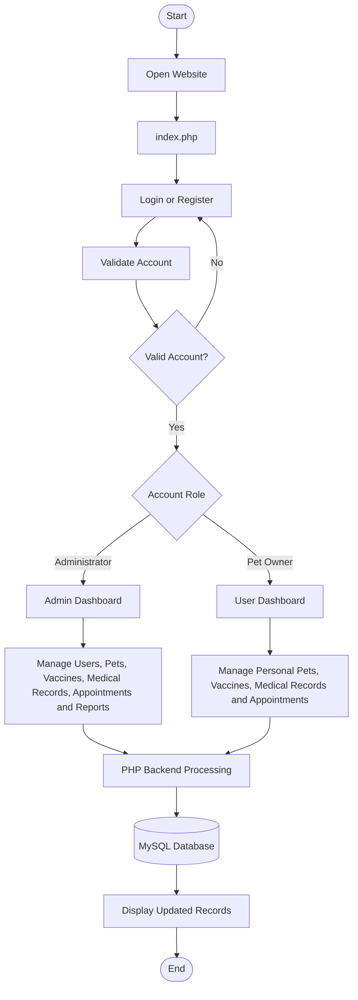

# 🐾 Pet-Care: Veterinary Clinic Record System with Vaccination Scheduling

A web-based veterinary clinic record management system designed to help organize pet information, vaccination schedules, medical histories, and appointment records.

**Live Website:** https://petcare.ifree.page

---

## 📌 Project Overview

Pet-Care is a web-based Veterinary Clinic Record System with Vaccination Scheduling developed to provide an organized and accessible platform for managing veterinary clinic information.

The system has two main user roles: Administrator and Pet Owner. Administrators can manage user accounts, registered pets, vaccination records, medical histories, appointments, and reports. Pet Owners can manage their own pets and maintain their vaccination, medical, and appointment records.

The application uses PHP for backend processing and MySQL for database management. Its interface is developed using HTML, CSS, and JavaScript.

This project was developed as a requirement for **Technical Elective III (Software Development)**.

## 🎯 Project Objectives

- Develop a web-based veterinary clinic record management system.
- Provide pet owners with a platform to manage their pets' information.
- Organize vaccination records and schedules.
- Maintain pet medical history.
- Provide an appointment management feature.
- Allow administrators to manage users and veterinary records.
- Generate organized clinic reports.

## ✨ Features and Functionalities

### 👨‍💼 Administrator Module

**Dashboard**
- View overall clinic statistics.
- Monitor registered users and pets.
- View vaccination, medical, and appointment statistics.
- Access quick actions and recent records.

**User Management**
- View registered accounts.
- Approve pending user registrations.
- Manage user account status.
- Search and review user information.

**Pet Management**
- View registered pets.
- Review pet information and owner details.
- Manage pet records.

**Vaccine Management**
- View vaccination records.
- Monitor overdue vaccinations.
- Identify vaccinations due today.
- Monitor upcoming vaccination schedules.
- Manage vaccine records.

**Medical Records**
- View pet medical histories.
- Review diagnoses and treatments.
- Manage medical records.

**Appointment Management**
- View submitted appointment requests.
- Review appointment information.
- Update appointment statuses.
- Manage appointment records.

**Reports**
- View vaccination reports.
- View medical history reports.
- View appointment reports.
- Print clinic reports.

### 🐶 Pet Owner Module

**Account Management**
- Register a new account.
- Log in and log out securely.
- Access the system after account approval.

**Pet Management**
- Add pet information.
- View registered pets.
- Edit pet information.
- Delete pet records.

**Vaccination Management**
- Add vaccination records.
- View vaccine information.
- Edit vaccination records.
- Delete vaccination records.
- View next vaccination schedules.

**Medical History**
- Add medical records.
- View diagnoses and treatments.
- Edit medical information.
- Delete medical records.

**Appointment Management**
- Submit appointment requests.
- Select a registered pet.
- Provide appointment date, time, and reason.
- View and manage appointment information.

---

## 🔄 How the System Works

The Pet-Care system follows a role-based workflow. The system identifies the account type after successful authentication and provides access to the appropriate dashboard.

### 1. Accessing the System

Users can access the application through the website's main entry point, `index.php`, which directs visitors to the login page.

New pet owners can register through the registration page, while existing users can log in using their account credentials.

### 2. Registration and Account Approval

1. A new pet owner opens the registration page.
2. The user provides the required account information.
3. The system validates the submitted information.
4. The password is hashed before it is stored in the database.
5. The newly registered account receives a Pending status.
6. The Administrator reviews and approves the registration.
7. Once approved, the pet owner can log in and access the system.

### 3. Login and Authentication

1. The user enters their username and password.
2. The system checks the submitted credentials against the database.
3. The system verifies the account status and user role.
4. If authentication is successful, the system creates an authenticated session.
5. The user is redirected to the appropriate dashboard based on their role.

### 4. Administrator Workflow

After successful login, the Administrator is redirected to the Admin Dashboard.

The Administrator can:

1. Monitor the clinic's statistics.
2. Approve and manage registered user accounts.
3. View and manage registered pets.
4. Monitor vaccination records and schedules.
5. Review pet medical histories.
6. Manage appointment requests and update their statuses.
7. Generate and print clinic reports.

### 5. Pet Owner Workflow

After successful login and account approval, the Pet Owner is redirected to the User Dashboard.

The Pet Owner can:

1. Register and manage pet information.
2. View their registered pets.
3. Select a pet to access its individual records.
4. Add and maintain vaccination records.
5. View next vaccination schedules.
6. Record medical information, including diagnosis and treatment.
7. Submit appointment requests.
8. View and manage their pet-related records.

### 6. Database Processing

The application uses PHP to process user requests and MySQL to store and retrieve system information.

When an authorized user adds, edits, or deletes a record:

1. The user submits a form.
2. PHP receives and validates the submitted information.
3. The system checks the user's permissions and record ownership when applicable.
4. Prepared SQL statements are used to perform database operations.
5. MySQL processes the requested operation.
6. The updated information is displayed in the application.

### 7. Appointment and Vaccination Monitoring

Pet Owners can submit appointment requests for their registered pets. Administrators can review these requests and update their statuses.

The system also monitors vaccination schedules using the recorded next vaccination dates. Vaccination records can be classified as:

- **Overdue** – The scheduled date has already passed.
- **Due Today** – The scheduled date is the current date.
- **Upcoming** – The scheduled date is in the future.
- **No Schedule** – No next vaccination date has been recorded.

### 8. System Output

The system provides separate dashboards and organized records based on user roles.

Administrators can access clinic-wide information and printable reports, while Pet Owners can access and manage information related to their own registered pets.

### System Workflow Diagram



---

## 💻 Technologies Used

| Technology | Purpose |
|---|---|
| PHP | Backend development and server-side processing |
| MySQL | Database management |
| HTML5 | Web page structure |
| CSS3 | User interface and styling |
| JavaScript | Client-side interactions |
| XAMPP | Local development environment |
| InfinityFree | Web hosting and deployment |
| Git | Version control |
| GitHub | Source code repository |

## 🗄️ Database Structure

The application uses a MySQL database named `project`.

The main database tables include:

| Table | Description |
|---|---|
| `users` | Stores administrator and pet owner account information, credentials, roles, and account statuses |
| `pets` | Stores registered pet information and owner relationships |
| `vaccines` | Stores vaccination records and next vaccination schedules |
| `medical_history` | Stores pet medical history, diagnoses, treatments, and notes |
| `appointments` | Stores appointment requests and their statuses |

### Database Relationships

- A user can register and manage multiple pets.
- Each pet belongs to a registered user.
- A pet can have multiple vaccination records.
- A pet can have multiple medical history records.
- A pet can have multiple appointment records.

---

## ⚙️ Installation and Setup

### System Requirements

- XAMPP
- PHP
- MySQL
- Web browser
- Git (optional)

### 1. Clone the Repository

Open the terminal and navigate to your XAMPP `htdocs` directory.

Execute:

```bash
git clone https://github.com/flordelizjhunjhun0-bot/pet-care-project.git
```

Alternatively, download the repository as a ZIP file from GitHub and extract it into the `htdocs` directory.

### 2. Project Directory

Make sure the project folder is located inside:

```text
C:\xampp\htdocs\Pet_Care\
```

### 3. Start XAMPP

1. Open XAMPP Control Panel.
2. Start Apache.
3. Start MySQL.

### 4. Create the Database

1. Open your browser.
2. Navigate to `http://localhost/phpmyadmin`.
3. Create a database named `project`.
4. Select the newly created database.
5. Import the provided `project.sql` file.
6. Verify that the required tables and columns are present.

### 5. Configure the Database Connection

Open the following file:

```text
db/db.php
```

Configure the database connection based on your local MySQL settings.

Example:

```php
$conn = new mysqli(
    "localhost",
    "root",
    "",
    "project"
);
```

Use the correct database credentials for your environment.

### 6. Run the Application

Open your browser and visit:

```text
http://localhost/Pet_Care/
```

The `index.php` file serves as the main entry point and directs visitors to the login page.

You may also access the login page directly:

```text
http://localhost/Pet_Care/Account/login.php
```

Register a new pet owner account or log in using an existing authorized account.

---

## 🌐 Deployment

The Pet-Care system is deployed using **InfinityFree** hosting.

**Live Website:** https://petcare.ifree.page

The deployed application uses a hosted PHP environment and MySQL database.

For deployment:

1. Upload the project files to the website's document root.
2. Create a MySQL database through the hosting control panel.
3. Import the project database SQL file.
4. Configure `db/db.php` using the hosting provider's database hostname, database name, username, and password.
5. Verify that the required database tables and columns are present.
6. Access the website through its live domain.

**Note:** Local XAMPP database credentials are different from InfinityFree database credentials. Use the hosting credentials when running the deployed application.

---

## 🔀 Development Workflow

Git and GitHub are used to manage source code, track development progress, and maintain project versions.

The project uses the following Git workflow:

| Git Command | Purpose |
|---|---|
| `git status` | Checks modified and untracked files |
| `git add` | Stages changes |
| `git commit` | Saves changes in the local repository history |
| `git switch` | Switches between branches |
| `git merge` | Combines changes from another branch |
| `git pull` | Retrieves and integrates remote changes |
| `git push` | Uploads local commits to GitHub |

### Branches Used

- **main** – Main branch containing the integrated project.
- **improvement** – Development branch used for system improvements and updates.

Changes developed in the improvement branch are merged into the main branch after development.

**GitHub Repository:** https://github.com/flordelizjhunjhun0-bot/pet-care-project

---

## 🔐 Security Features

The system implements the following security measures:

- Password hashing for account credentials.
- Prepared SQL statements for database operations.
- Session-based authentication.
- Role-based access control for administrators and pet owners.
- Input validation and output escaping.
- CSRF token validation for protected form submissions.
- Pet ownership verification to prevent unauthorized access to other users' records.
- Login attempt monitoring and account protection.

---

## 📁 Project Structure

```text
Pet_Care/
│
├── index.php
│
├── Account/
│   ├── login.php
│   ├── register.php
│   ├── logout.php
│   └── style.css
│
├── Admin/
│   ├── admin_dashboard.php
│   ├── admin_appointment.php
│   ├── admin_medical.php
│   ├── admin_vaccine.php
│   ├── manage_pets.php
│   ├── manage_users.php
│   ├── reports.php
│   └── admin.css
│
├── User/
│   ├── user_dashboard.php
│   ├── add_pet.php
│   ├── edit_pet.php
│   ├── my_pet.php
│   ├── view.php
│   ├── add_vaccine.php
│   ├── edit_vaccine.php
│   ├── add_medical.php
│   ├── edit_medical.php
│   ├── add_appointment.php
│   ├── edit_appointment.php
│   └── users.css
│
├── db/
│   └── db.php
│
├── project.sql
│
└── README.md
```

*Note: This represents the main project structure. Additional supporting, action, edit, and delete PHP files may also be included in the repository.*

---

## 👥 System Users

### Administrator

The Administrator is responsible for managing the overall system, including registered users, pet information, vaccination records, medical histories, appointments, and reports.

### Pet Owner

The Pet Owner is responsible for maintaining their pets' information, vaccination records, medical histories, and appointment requests.

---

## 📌 Project Information

| Information | Details |
|---|---|
| Project Title | Pet-Care: Veterinary Clinic Record System with Vaccination Scheduling |
| Course | Technical Elective III (Software Development) |
| Program | Bachelor of Science in Computer Engineering |
| Backend | PHP |
| Database | MySQL |
| Frontend | HTML, CSS, JavaScript |
| Local Environment | XAMPP |
| Hosting Platform | InfinityFree |
| Version Control | Git and GitHub |

## 📄 License

This project was developed for academic purposes as part of a Technical Elective III software development requirement.